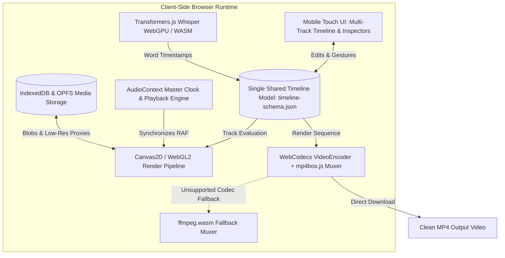

# System Architecture & Technical Audit: claude-music & PulseCut Studio

This document contains a comprehensive architectural audit of the existing codebase (`claude-music`, AI Reel Maker, and Mobile Editor Panel), analyzes data formats and execution pipelines, identifies existing proprietary/paid dependencies, and outlines the integration path toward a 100% free, client-side, browser-native video editor web application.

---

## 1. Tech Stack & Folder Structure of Existing Projects

The workspace contains an integrated suite for AI music generation, vertical video creation, and clip editing:

```
d:/Git/music claude/
├── skills/
│   ├── claude-music/                   # Core Python & Shell orchestrator
│   │   ├── config.json                 # ACE-Step & model path configuration
│   │   ├── reel_autoedit.py            # Automated EDL, audio ducking & FFmpeg filtergraph builder
│   │   ├── shorts_engine.py            # ShortsEngine: transcription, virality, trimming, ASS subtitles
│   │   ├── SKILL.md                    # Claude Code skill definition
│   │   ├── scripts/                    # Shell CLI wrappers & test harnesses
│   │   │   ├── music_engine.py         # Subcommand dispatcher for ACE-Step 1.5 DiT
│   │   │   └── ...
│   │   └── webapp/                     # Local Web Studio & Editor Dashboard
│   │       ├── server.py               # Python ThreadingHTTPServer (loopback 127.0.0.1:8765)
│   │       ├── index.html              # Monolithic SPA (HTML5, CSS3, Vanilla ES6)
│   │       └── genres.json             # Genre prompt presets
│   ├── claude-music-generate/          # Sub-skill: Music generation
│   ├── claude-music-cover/             # Sub-skill: Style transfer / covers
│   ├── claude-music-enhance/           # Sub-skill: Audio mastering & prompt expansion
│   ├── claude-music-compose/           # Sub-skill: Multi-section composition
│   └── ...                             # Other sub-skills (repaint, lora, etc.)
├── output/                             # Default media output directory
│   ├── shorts/                         # Rendered MP4 shorts, thumbnails, EDLs
│   ├── uploads/                        # Uploaded source videos & custom audio tracks
│   └── .claude-music/                  # Metadata cache (shorts_library.json, transcripts)
└── tests/                              # Pytest suite (71 passing automated tests)
```

### Component Tech Stacks:
1. **AI Reel Maker & Shorts Engine (`shorts_engine.py`, `reel_autoedit.py`)**:
   - **Runtime**: Python 3.11+
   - **Video Processing Engine**: Native desktop FFmpeg CLI (`subprocess.Popen`)
   - **Speech Recognition / Transcription**: `faster-whisper` (CTranslate2 / cuDNN backend) with heuristic fallback
   - **Voice Synthesis**: `edge-tts` (Microsoft Edge online service)
   - **Face Detection & Reframe**: OpenCV (`cv2.CascadeClassifier` with `haarcascade_frontalface_default.xml`)
   - **Video Downloader**: `yt-dlp` CLI
   - **Metadata & LLM Virality**: `google-genai` (Gemini 2.5 Flash) with fallback rule-based heuristics

2. **Web Dashboard & Editor (`skills/claude-music/webapp/`)**:
   - **Backend**: Python `http.server.ThreadingHTTPServer` bound strictly to `127.0.0.1`.
   - **Frontend**: Zero-dependency vanilla ES6 JavaScript, HTML5, CSS custom properties.
   - **Styling**: Dark mode mobile-responsive design, flexbox/grid layout, custom controls.
   - **Data Transport**: RESTful JSON endpoints (`/api/shorts/*`, `/api/voiceover/*`) + streaming binary endpoints for video chunk playback (`Range` header support) and file uploads.

---

## 2. Storage & Rendering Pipeline Audit

### A. How Media is Stored Today
- **Video Files**:
  - Raw uploads: `output/uploads/<safe_filename>.mp4`
  - Rendered shorts: `output/shorts/<clip_id>.mp4` (H.264 high profile, AAC stereo)
- **Thumbnails**:
  - `output/shorts/<clip_id>.jpg` (captured at 1.0s or mid-point via `ffmpeg -vframes 1`)
- **Speech Transcripts**:
  - `output/.claude-music/transcripts/<stem>.json` storing Whisper output:
    ```json
    {
      "segments": [
        {
          "start": 0.0,
          "end": 2.4,
          "text": "The secret to building viral apps",
          "words": [
            {"word": "The", "start": 0.0, "end": 0.2},
            {"word": "secret", "start": 0.25, "end": 0.65}
          ]
        }
      ]
    }
    ```
- **Project & Shorts Library**:
  - `output/.claude-music/shorts_library.json` maintaining an array of entries:
    `id`, `title`, `duration`, `score`, `hook_sentence`, `start_time`, `end_time`, `filename`, `thumbnail`, `created_at`, `aspect_ratio`, `layout`, `captions`, `source_file`, `quality`, `effect`, `sticker`.

### B. How Media is Rendered Today
All rendering occurs **server-side** via FFmpeg CLI commands executed by Python:
- **Clip Cutting & Trimming**:
  Uses `-ss {start}` and `-t {duration}` or FFmpeg `trim` / `atrim` filter graphs.
- **Aspect Ratio & Framing**:
  Vertical 9:16 (1080x1920), Square 1:1 (1080x1080), Portrait 4:5 (1080x1350), or Landscape 16:9 (1920x1080) rendered via `scale={w}:{h}:force_original_aspect_ratio=increase,crop={w}:{h},setsar=1`.
- **Text & Animated Captions**:
  Generates Advanced SubStation Alpha (`.ass`) subtitle files. Words are grouped into 3-word chunks with dynamic highlighted colors (`&H0022FFFF&` cyan / yellow highlight). Burned directly into the video stream with `ass=filename='...'`.
- **Sticker Overlays**:
  Text badges (`🔥 MUST WATCH`, `💡 LIFE HACK`, etc.) rendered via ASS dialogue styles with fixed positioning (`{\an7\pos(60,110)}`).
- **Visual Effects**:
  - Vintage VHS: `curves=vintage,noise=c1s=8:c0s=8:allf=t,unsharp=5:5:0.8`
  - 35mm Film Grain: `noise=alls=14:allf=t,colorbalance=rs=0.08:gs=0.02:bs=-0.05,eq=contrast=1.06`
  - Soft Glow: `gblur=sigma=1.2,eq=contrast=1.10:brightness=0.02:saturation=1.15`
  - Teal & Orange: `colorbalance=rs=-0.05:gs=0.0:bs=0.10:rh=0.08:bh=-0.06,eq=contrast=1.12`
  - B&W Noir: `hue=s=0,eq=contrast=1.25:brightness=-0.02`
  - Punch Zoom: `zoompan=z='min(zoom+0.001,1.1)':d=125:s={w}x{h}:fps=30`
- **Audio Mixing & Mastering**:
  Dual-track mixer using `amix=inputs=2:duration=first:dropout_transition=2`.
  Broadcast vocal processing: `highpass=f=80,afftdn=nf=-25,acompressor=...,equalizer=...`.
  Music sidechain ducking: `sidechaincompress=threshold=0.03:ratio=8:attack=20:release=300`.
  Final master: `loudnorm=I=-14:TP=-1:LRA=11` with smooth outro fades (`fade=t=out`, `afade=t=out`).

---

## 3. What the AI Reel Maker Outputs Today

When a user processes a video or stages multiple clips, the reel maker generates:
1. **Flattened Video File (`.mp4`)**: Final compiled video with burned-in subtitles, visual effects, and mixed audio.
2. **Thumbnail Image (`.jpg`)**: 1080x1920 poster frame for preview cards.
3. **Edit Decision List (`.edl.json`)**: Array of cuts detailing source timestamps, output timestamps, active zoom level, and spoken sentence text.
4. **Library Record**: Entry in `shorts_library.json`.
5. **Viral SEO Metadata**: Clickable title options, video-synced description with timestamps (`0:00 - Hook`, `0:15 - Insight`), hashtags, tags, and pinned engagement comment.

---

## 4. UI Elements Reusable for the Client-Side Mobile Editor

The existing editor panel (`#manual-reel-editor-panel` in `index.html`) contains battle-tested UI controls that directly map to a mobile touch video editor:

| Component in `index.html` | Existing Capabilities | Target Mobile Editor Role |
|---|---|---|
| `.phone-frame` & video player | 9:16 aspect preview, play/pause, timecode overlays | Live WebGL/Canvas viewport with touch play/pause & drag scrub |
| `#trim-start`, `#trim-end`, nudge buttons | Numeric in/out points, `-0.5s` / `+0.5s` nudges, `⏱️ Current` | Playhead snap buttons & fine-tuning trim handles |
| `#manual-ratio-pills` | 9:16, 1:1, 4:5, 16:9 aspect ratio toggles | Project canvas settings & format reframing |
| `#manual-video-vol-slider` & mute toggle | 0% to 200% volume slider + mute switch | Per-clip and per-track audio inspector |
| `#manual-music-vol-slider` & mute toggle | 0% to 100% background music slider + mute switch | Background audio track volume & ducking control |
| `#manual-custom-music-file` | File picker for external audio tracks | Audio media import modal (OPFS/Blob storage) |
| `#manual-sticker-pills` | 10 viral badge pills | Sticker & Graphic Overlay track items |
| `#manual-effect-pills` | Clean, VHS, Grain, Glow, Teal/Orange, B&W, Zoom | Shader / Canvas filter stack presets |
| `#manual-burn-captions-check` & style | Checkbox toggle + Hormozi / Clean style | Dynamic subtitle track toggle & styling inspector |
| `#manual-quality-select` | 1080p Standard, Ultra HD, 720p, 4K | Client-side WebCodecs / ffmpeg.wasm export resolution picker |
| `#shorts-multi-clip-container` | Card-based clip list, reordering up/down, delete | Base concept for multi-track timeline track items |

---

## 5. Audit of Paid APIs, Proprietary Names & License Risks

| Dependency / Asset | Current Usage | Status / Risk | Client-Side Elimination Strategy |
|---|---|---|---|
| **Google Gemini API (`google-genai`)** | Metadata & virality ranking in `shorts_engine.py` | Requires API key & network connectivity; potential API cost | Replace with pure client-side heuristic engine & sentiment/lexical analyzer in JS |
| **Microsoft Edge TTS (`edge-tts`)** | Voiceover synthesis | Uses Microsoft cloud endpoint (undocumented / brittle) | Replace with browser native Web Speech API (`speechSynthesis`) or client-side Piper WASM |
| **faster-whisper / Whisper Python** | Word-level speech transcription | Heavy native binary (CTranslate2, CUDA/C++) running on server | Replace with client-side **Transformers.js** (`whisper-tiny.en` / `whisper-base` running ONNX WebAssembly / WebGPU) |
| **Desktop FFmpeg executable** | Server-side CLI processing | Requires host installation of FFmpeg CLI | Replace with **WebCodecs API** (hardware accelerated) with **ffmpeg.wasm** fallback |
| **"Instagram Edits" Naming** | Used in UI strings and CSS class comments | Trademark / naming violation risk | **Eliminated**: Renamed to neutral, original product identity: **PulseCut Web Studio** |
| **External Copyrighted Music** | Local audio files | Risk of DMCA takedowns | Built-in royalty-free Web Audio synthesizer + royalty-free Creative Commons / Public Domain sound banks |
| **Proprietary Fonts** | System Arial / Comic Sans fallbacks | Inconsistent cross-device rendering | Use open-source SIL OFL fonts loaded via Google Fonts (Inter, Montserrat, Space Grotesk, Bangers) |

---

## 6. Target Client-Side Architecture (PulseCut)


